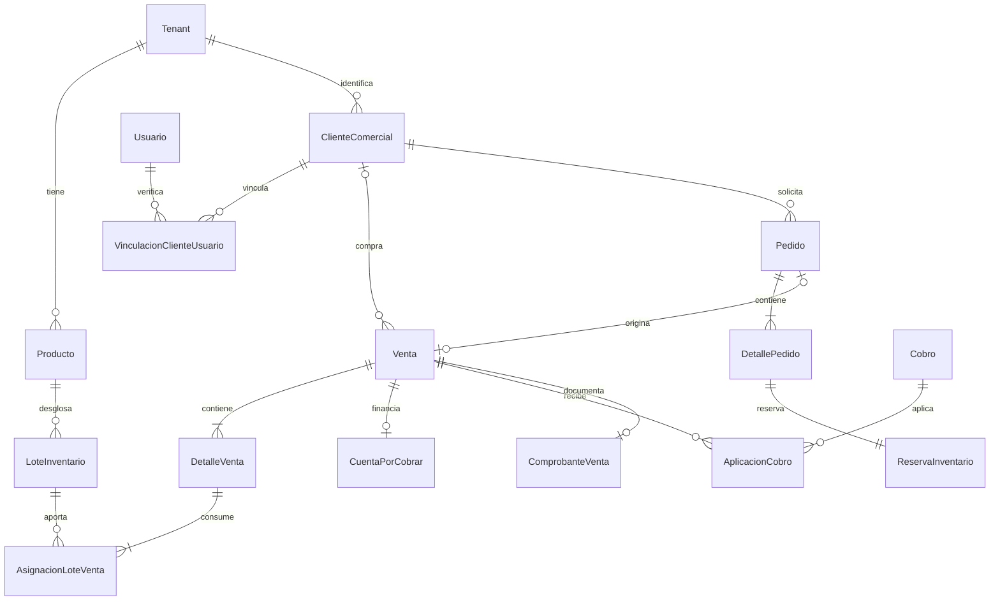

# Diseño de ampliación de la base de datos para STORE

Fecha: 2026-11-01. Estado: propuesta para revisión, previa a implementación.

## 1. Alcance y decisiones

Este documento diseña la ampliación de la base existente. No es un schema Prisma
ejecutable ni crea tablas. La siguiente etapa será traducir el diseño revisado a
Prisma 6.10.1 y SQL, por bloques. Backend, interfaces y producción son etapas
independientes. El diagnóstico anterior está en `PRISMA_STORE_DESARROLLO.md`.

Decisiones confirmadas por el usuario:

- Un negocio es un `Tenant`. La cuenta `Usuario` es global y puede relacionarse
  con distintos negocios. Los datos operativos permanecen separados.
- Cantidades enteras. Peso y fracciones quedan para una implementación futura.
- El personal registra costo de adquisición y precio de venta. El precio vigente
  corresponde a un producto y presentación concretos, no a toda una categoría.
  Se aplica a todas sus unidades sin cambiar costos de entrada ni ventas pasadas.
- Selección manual de lote. No implementar selección automática FIFO/FEFO ahora.
- Retiro y pago en tienda. Reserva de máximo una hora desde la confirmación;
  prepararlo no extiende el plazo. Vencida la reserva se crea otro pedido.
- El precio confirmado se mantiene durante esa hora. Un pedido nuevo toma el
  precio vigente. La expiración no cambia el historial del pedido anterior.
- Comprobantes `COMP-1`, `COMP-2`, etc., consecutivos por negocio. Los anulados
  conservan su número y este no vuelve a utilizarse.
- SRI y pagos en línea quedan fuera del alcance inicial. No hay integración de
  envíos en esta etapa.

Supuestos de esta propuesta, distintos de decisiones ya confirmadas:

- Un local y una moneda USD por negocio inicialmente. No crear sucursales,
  variantes ni conversiones de moneda ahora. Una presentación diferente será
  otro producto. Una futura sucursal exigirá ampliar la ubicación del stock.
- Una asignación de rol vigente por miembro del personal inicialmente; cada rol
  puede contener muchos permisos. No se requieren varios roles simultáneos.
- Un comprobante interno original por venta, más sus anulaciones trazables.
  Reemisiones fiscales o documentos tributarios serán otro alcance.

## 2. Convenciones e integridad común

Para tablas nuevas, usar `id Int` autoincremental, `tenantId Int`, `createdAt` y
`updatedAt` cuando sean editables. En movimientos inmutables, fecha de creación
y fecha efectiva; las correcciones se registran como movimientos inversos.

Importes finales, precios de venta y saldos: `Decimal(18,2)`. Costos unitarios:
`Decimal(18,4)`; porcentajes: `Decimal(7,4)`. Cantidades: `Int`, positivas en
detalles y deltas con signo en movimientos. Redondear importes por línea a dos
decimales mediante regla explícita HALF_UP; sumar líneas redondeadas para el
documento. Costo histórico por línea conserva cuatro decimales y los reportes
redondean su presentación final. No calcular dinero nuevo con aritmética Float.

Fechas operativas nuevas: `timestamptz(3)`, instantes UTC. Agregar
`Tenant.zonaHoraria`, inicialmente `America/Guayaquil`. Rangos por periodo se
traducen a límites UTC desde esa zona. Vencimientos y reservas usan reloj del
servidor, nunca el dispositivo del cliente.

Cada tabla nueva de negocio tendrá `UNIQUE(tenantId,id)`. Sus relaciones usarán
claves foráneas compuestas `(tenantId,referenciaId)` hacia `(tenantId,id)`. Las
tablas actuales referenciadas recibirán esa clave única adicional sin cambiar
sus claves primarias. Ejemplo: una venta del negocio A no puede referenciar un
producto o cliente comercial del negocio B aunque su ID exista.

Las relaciones que deban compartir también producto, cliente o venta añadirán
esas columnas a la clave de referencia: no basta con compartir tenant. Las
combinaciones opcionales llevan CHECK para evitar relaciones parcialmente nulas.
Usuarios globales no tienen tenant; acciones de personal referencian `UserTenant`
y guardan la identidad/rol usados como snapshot. El backend comprueba membresía
activa y facultades en el momento de la acción.

Documentos, finanzas, movimientos y auditoría: `ON DELETE RESTRICT`. Desactivar
clientes, productos y personal; no borrarlos cuando tengan operaciones. Las
nuevas referencias financieras también impedirán que un borrado en cascada
actual de membresías elimine su trazabilidad. No ejecutar ese borrado como flujo
de baja. Datos de prueba o borrados futuros requieren su propio procedimiento.

## 3. Modelos conservados y ampliados

Relaciones principales (cada referencia operativa incluye tenant):



Una venta completada tiene asignaciones de costo por sus lotes; un pedido
confirmado todavía no tiene venta ni selección de lote. El diagrama resume
cardinalidades, no reemplaza las restricciones y tablas detalladas posteriores.

| Modelo actual | Tratamiento propuesto |
| --- | --- |
| `Usuario` | Conservar cuenta, identificadores y credenciales. No crear cuentas artificiales para compradores. |
| `Tenant`, `TenantModule` | Conservar. Añadir zona horaria y versiones de autorización/transición. STORE solo se habilita después de las adaptaciones funcionales. |
| `UserTenant`, `StaffProfile` | Conservar mientras se migra autorización. La membresía es la identidad del personal dentro del negocio; perfil laboral no concede permisos por separado. |
| `Cliente` | Conservar `id`, campos deportivos y todas las relaciones actuales. El cliente comercial se enlaza opcionalmente sin trasladar membresías ni deudas. |
| `Producto` | Conservar ID y `stock`. Ampliar catálogo, cantidad reservada y modo de inventario. Estudiar y adaptar su precio a Decimal en un cambio específico. |
| `Compra` | Conservar historial y contratos del gimnasio. No representa compra a proveedores. No copiar automáticamente a ventas ni duplicar ingresos. |
| `Plan`, `ClientePlan`, `Pago`, `Deuda`, `Factura` | Conservar modelos, importes históricos Float y contratos del gimnasio. Las finanzas comerciales no requieren `ClientePlan`. |
| `CambioPlan`, `DevolucionMovimiento` | Conservar para gimnasio. No reutilizar para reembolsos comerciales. |
| `Gasto`, `IngresoRapido` | Conservar para reportes actuales. No registrar además una venta nueva como ingreso rápido. |
| Entrenamientos, rutinas, medidas, asistencias y restantes modelos GYM | Conservar. No forman parte de esta refactorización. |

### Precio único y transición de Producto

Destino: `Producto.precio Decimal(18,2)` como único precio vigente. No agregar
un precio independiente por lote ni dos columnas monetarias activas que compitan.
Los precios reservados y vendidos son snapshots de operaciones, no catálogo.

Cambiar este Float exige revisar antes valores fuera de rango, negativos,
no finitos y diferencias al redondear; conservar una copia verificable de los
valores originales. Si los datos no son compatibles, detener ese bloque y
presentar las diferencias, sin redondear silenciosamente. Esta conversión es
solo del precio del producto; no de todos los Float del gimnasio.

Adaptar `ProductoService`, el cálculo `producto.precio * cantidad` actual de
`CompraService` y las respuestas legacy que esperan `number`. El backend nuevo
opera con Decimal; los adaptadores legacy convierten explícitamente en su borde
según el contrato existente y prueban redondeos. El despliegue debe coordinarse
con esas adaptaciones; una migración aislada no conserva la compatibilidad.

## 4. Clientes y acceso al portal

| Tabla nueva | Campos y relaciones principales |
| --- | --- |
| `ClienteComercial` | `tenantId`, nombres/razón social, identificación opcional con tipo, contacto opcional, activo, `clienteGymId?`. Enlace opcional y único al `Cliente` del mismo tenant. |
| `VinculacionClienteUsuario` | Cliente comercial, `usuarioId`, fecha de verificación, método, verificador opcional y revocación. Una vinculación activa por cliente y por usuario dentro del negocio, mediante índices únicos parciales. |

El comprador puede existir sin cuenta y sin datos deportivos. Una venta anónima
no tiene cliente. Venta a crédito requiere cliente comercial identificado. Los
datos del receptor del comprobante se guardan en el documento aunque luego se
edite la ficha del cliente.

Crear una vinculación requiere prueba de control de cuenta y verificación del
cliente por un flujo autorizado; escribir cédula o correo no basta. No vincular
en masa por coincidencias textuales. Si se enlaza a `Cliente`, comprobar también
la coherencia con su `usuarioId`; no cambiar la titularidad existente.

El portal consulta las membresías y deudas GYM originales, y las operaciones
comerciales originales según la vinculación verificada. No se copian en tablas
del portal. Las consultas deben separar ambos tipos de saldo.

`AuthService` actualmente descubre contextos cliente únicamente desde `Cliente`.
Para admitir cuentas de tienda sin gimnasio habrá que extender el contexto con
un identificador comercial opcional y preservar login/select-context y los
clientes existentes. No inventar un `Cliente.id` para llenar el token.

## 5. Roles y permisos

| Tabla nueva | Campos y restricciones principales |
| --- | --- |
| `Permiso` | Catálogo global definido por la aplicación: código único, módulo, descripción y si es delegable. No son permisos arbitrarios creados por el administrador. |
| `RolNegocio` | Tenant, código/nombre únicos por tenant, activo, protegido, equivalencia legacy opcional. Roles iniciales OWNER, ADMIN, CAJERO, BODEGUERO y los correspondientes del gimnasio. |
| `RolPermiso` | Tenant, rol y permiso. Único por rol/permiso; el rol pertenece al mismo tenant. |
| `AsignacionRol` | Tenant, membresía `UserTenant`, rol, fecha y asignador. Única por membresía: un rol vigente. Los cambios se auditan. |

Transición: `Tenant.autorizacionVersion = LEGACY | PERMISOS`. Mientras esté en
LEGACY, `UserTenant.role` sigue siendo la fuente utilizada por autorización GYM
y `StaffProfile.tenantRole` sigue su sincronización actual. Preparar roles y
asignaciones equivalentes sin cambiar todavía el guard de rutas existentes.

Al habilitar PERMISOS para un negocio, `AsignacionRol` será la fuente efectiva;
los campos legacy serán proyecciones mantenidas por un único servicio, no otra
fuente editable. Un rol personalizado sin equivalencia staff heredará como
proyección EMPLEADO, nunca ADMIN/OWNER. Los módulos nuevos usan permisos.

Adaptar guards, DTO de personal, JWT y selección de contexto antes de activar la
versión nueva. Cambios de rol/permisos deben invalidar o revalidar autorizaciones
de tokens antiguos. Comprobar membresía y estado actual, no confiar solo en un
rol que permanece en un JWT anterior.

OWNER conserva sus facultades; las operaciones de propiedad no son delegables
mediante un rol personalizado. ADMIN solo asigna permisos delegables de su
negocio dentro de su techo de autoridad. Crear un rol no habilita módulos del
SaaS ni permite escalar a OWNER. SQL protege referencias; estas decisiones de
autorización requieren backend.

## 6. Catálogo

| Tabla/modelo | Campos propuestos |
| --- | --- |
| `CategoriaProducto` nueva | Tenant, módulo GYM/STORE, nombre normalizado, activo. Único `(tenantId,modulo,nombreNormalizado)`. |
| `Producto` ampliado | `categoriaId?`, `sku?`, `codigoBarras?` texto, marca/presentación opcionales, `unidadVenta` inicialmente UNIDAD, descripción, timestamps, `stockReservado Int default 0`, `modoInventario` LEGACY o LOTES, inicialmente LEGACY. |
| `ProductoImagen` nueva | Tenant, producto, URL/clave de archivo, texto alternativo y orden; único producto/orden. |

SKU y código de barras únicos por tenant cuando existan; normalizar cadena vacía
a null sin convertir el código a número. El nombre no identifica por sí solo un
producto. Categoría es opcional para productos anteriores y debe ser del mismo
tenant. El backend comprueba que el módulo esté habilitado. Un producto puede
ser compartido por los flujos de un negocio MIXTO sin duplicar su stock.

No eliminar productos con historial. Estado inactivo impide nuevas ventas y
reservas; los registros previos conservan sus datos.

## 7. Inventario y costo manual

| Tabla nueva | Campos y relaciones principales |
| --- | --- |
| `EntradaInventario` | Tenant, responsable, fecha, referencia externa opcional y justificante; agrupa recepción manual. No usar `Compra` para esto. |
| `LoteInventario` | Tenant, producto, entrada, código de lote, vencimiento opcional, `costoUnitario Decimal(18,4)`, `cantidadFisica Int`. Entradas a distinto costo generan lotes de costo distintos aunque coincida el código del fabricante. |
| `MovimientoInventario` | Tenant, producto, lote opcional, tipo, `deltaFisico`, `deltaReservado`, costo aplicado, responsable, fecha, motivo, operación/idempotencia y relaciones explícitas de origen. |
| `ReservaInventario` | Tenant, pedido/detalle, producto, cantidad, estado ACTIVA/CONSUMIDA/LIBERADA/EXPIRADA, fecha límite. Única por detalle de pedido. |
| `AsignacionLoteVenta` | Tenant, detalle de venta, lote, cantidad y costo unitario histórico. Permite entregar una línea desde varios lotes elegidos manualmente. |

La reserva se hace sobre producto, sin elegir automáticamente un lote. El
personal indica lote(s) al vender/entregar; no es necesario que el cliente los
elija. Para productos sin vencimiento también se distingue la entrada/costo;
su registro puede presentarse como una entrada simple en la interfaz futura.

Fuente del saldo físico operativo: `Producto.stock`. Fuente de reservas:
`ReservaInventario` activa, proyectada atómicamente en `Producto.stockReservado`.
Los lotes son el desglose obligatorio del mismo stock para modo LOTES, no un
inventario alternativo. El historial explica las variaciones desde la apertura.

Invariantes al confirmar cada transacción en modo LOTES:

```
Producto.stock = SUM(LoteInventario.cantidadFisica)
Producto.stockReservado = SUM(reservas activas del producto)
disponible = Producto.stock - Producto.stockReservado
0 <= stockReservado <= stock
cantidadFisica de cada lote >= 0
stock = saldo de apertura + SUM(deltaFisico posterior)
stockReservado = SUM(deltaReservado desde la apertura)
```

El disponible es una condición necesaria: confirmar/entregar además exige
suficiente cantidad en lotes aptos, no vencidos. Las reservas activas deben caber
en el stock apto en el momento de confirmarlas. Un vencimiento posterior nunca
autoriza entregar producto vencido: se libera/cancela si no puede cumplirse.
La baja del lote vencido es una operación explícita, no un borrado automático.

Las reservas vencidas pendientes de procesar no se consumen. Liberarlas en
transacción antes de reutilizar esa capacidad. Un proceso periódico ayuda a
liberar, pero su retraso no hace válido un pedido vencido.

Restricciones CHECK en columnas y triggers diferidos revisados para conciliar
las sumas de lotes, reservas y deltas al final de la transacción. Estos últimos
no se expresan solo con Prisma. Usar bloqueos de producto también en los triggers
o protocolo equivalente: una comprobación agregada sin bloqueo no evita carreras.
La conciliación por consultas será un control adicional, no una excusa para
permitir saldos inconsistentes al confirmar.

Transición desde LEGACY: inventariar y conciliar el stock actual, crear los lotes
de apertura y su movimiento sin incrementar nuevamente `Producto.stock`, y
cambiar el modo dentro de una transacción. No inventar costos/vencimientos de
existencias anteriores: deben identificarse manualmente. Si no es posible,
mantener ese producto en LEGACY y fuera del flujo STORE hasta conciliarlo.

Antes de LOTES, adaptar todas las escrituras: creación/edición de stock,
`CompraService`, ventas, bajas, ajustes, devoluciones y reservas. Para productos
LOTES, el endpoint antiguo de compra debe pasar por el mismo servicio de
inventario, y editar stock directamente debe quedar prohibido. Una restricción
de conciliación también debe impedir escrituras que omitan lotes o movimientos.
Conservar la respuesta legacy sin registrar además una segunda venta financiera.

Movimiento tiene origen controlado: recepción, apertura, detalle de venta,
reserva, devolución o ajuste/baja justificado. CHECK de origen exclusivo y de
deltas por tipo; FK compuesta incluye producto para lote y para detalle origen.
Reserva/liberación solo cambia reservado; salida por venta cambia físico;
consumir reserva cambia ambos. Reversión apunta al movimiento original y no
permite revertir más cantidad. Registrar costo real, no el precio de venta.

## 8. Carrito y pedidos

| Tabla nueva | Campos principales |
| --- | --- |
| `Carrito` / `DetalleCarrito` | Tenant, cliente comercial/usuario verificado, producto y cantidad. Un carrito activo por cliente/tenant. El precio mostrado no es vinculante. |
| `Pedido` | Tenant, cliente comercial, número interno, origen PORTAL, estado, `confirmadoAt`, `reservaHasta`, `entregadoAt?`, totales Decimal, clave idempotente. Retiro en tienda como único canal inicial. |
| `DetallePedido` | Producto, cantidad, nombre/presentación/código, precio, descuentos, tasa/impuesto y totales confirmados como snapshots. |
| `HistorialEstadoPedido` | Pedido, estado anterior/nuevo, fecha, usuario responsable o actor SISTEMA y motivo. |

Transiciones iniciales:

```
CONFIRMADO -> EN_PREPARACION -> ENTREGADO
CONFIRMADO o EN_PREPARACION -> CANCELADO o EXPIRADO
```

`ENVIADO` se reserva conceptualmente para una ampliación del canal de envío; no
crear una transición de despacho ficticia para un retiro en tienda.

Confirmar carrito: validar cliente, precios y stock en servidor; bloquear los
productos en orden por ID; liberar reservas vencidas afectadas; crear pedido,
detalles y reservas; incrementar reservado y emitir historial/outbox en una
transacción. `reservaHasta = confirmadoAt + 1 hora`, inmutable y CHECK SQL del
máximo. Repetir la misma solicitud devuelve el pedido original.

Entregar: bloquear pedido/productos/reservas, exigir hora actual anterior a
`reservaHasta`, permiso, lotes manuales aptos y cobro en tienda. Crear una sola
venta, sus asignaciones de lote y cobros; consumir reservas; descontar físico
una vez; marcar ENTREGADO; agregar historial y notificaciones en la transacción.
Como excepción, crédito solo si personal autorizado lo aprueba y cliente está
identificado; el portal no concede crédito por sí mismo.

Liberación/cancelación/expiración no cambia físico. Expirar conserva los precios
históricos del pedido y no renueva su plazo. Un nuevo pedido se revalida completo.

## 9. Ventas, costos, cartera y cobros

| Tabla nueva | Campos y relaciones principales |
| --- | --- |
| `Venta` | Tenant, cliente comercial opcional, responsable, origen CAJA/PORTAL, `pedidoId?` único por tenant, fecha, estado COMPLETADA/ANULADA, subtotal, descuento, impuesto, total, motivo/autor/fecha de anulación, idempotencia. |
| `DetalleVenta` | Venta, producto, cantidad y snapshots de nombre, presentación, código, precio, descuento e impuesto. Costos históricos se desglosan en `AsignacionLoteVenta`; su suma da el costo de la línea. |
| `Cobro` | Tenant, cliente opcional, monto, método EFECTIVO/TRANSFERENCIA/TARJETA/OTRO, fecha, responsable, turno cuando corresponda, referencia y estado CONFIRMADO/REVERSADO. Confirmación por personal autorizado; sin proveedor de pagos en línea. |
| `AplicacionCobro` | Cobro, venta, cuenta por cobrar opcional, importe positivo, fecha y responsable. La cuenta, si existe, debe pertenecer a esa misma venta y cliente. |
| `ReversionAplicacionCobro` | Aplicación original única, responsable, fecha y motivo. Revierte toda esa aplicación; para correcciones parciales crear aplicaciones desglosadas. No borrar el registro original. |
| `CuentaPorCobrar` | Tenant, cliente obligatorio, venta única, importe financiado inicial inmutable, importe exigible actual y saldo proyectados, vencimiento, estado ABIERTA/PAGADA/CANCELADA. |
| `AjusteCuentaPorCobrar` | Cuenta y venta del mismo cliente, delta de importe exigible, fecha, responsable, motivo y origen exclusivo devolución, anulación o corrección del pago inicial. Historial inmutable; no es un cobro ni ingreso. |
| `Reembolso` | Cobro y venta de origen, aplicación original cuando corresponda, importe, método de devolución, responsable, turno de efectivo si corresponde, motivo y referencia a anulación/devolución. Las FK preservan venta/cobro/cliente. No usar `DevolucionMovimiento` GYM. |

Una venta de 100 con pago inicial de 20 genera una cuenta de 80, no de 100.
La aplicación inicial apunta a la venta sin cuenta; los abonos posteriores
apuntan a venta y cuenta. Cada aplicación cuenta una sola vez:

```
totalVentaNeto = totalVenta - devoluciones comerciales aprobadas
saldoVenta = totalVentaNeto - aplicaciones vigentes de la venta
importeExigible = importeFinanciadoInicial + SUM(ajustes de la cuenta)
saldoCuenta = importeExigible - aplicaciones vigentes de la cuenta
cobroDisponible = montoCobro - aplicaciones vigentes - reembolsos confirmados
```

En venta completada a crédito ambos saldos deben coincidir. En una venta sin
devoluciones ni ajustes, las fórmulas se reducen al ejemplo 100/20/80. Aplicaciones
vigentes excluyen las revertidas y los cobros reversados. Una corrección del
pago inicial de una venta a crédito debe registrar el ajuste explícito del
importe exigible mediante operación auditada, o anular/reemitir; no reescribir
el importe inicial ni dejar saldos distintos por revertir un pago sin tratar
su financiación.

Para saldoCuenta y estados se permiten proyecciones actualizadas atómicamente
y conciliadas con el historial; no editarlos por CRUD genérico. SQL CHECK
`0 <= saldo <= importeExigible` e `importeExigible >= 0`. Bloquear cobro, venta y
cuenta antes de aplicar,
revertir o reembolsar; validar sumas y evitar sobreaplicación/saldo negativo.
Cobro reversado requiere revertir sus aplicaciones de forma consistente; un
reembolso es salida de dinero, no otro cobro ni una venta negativa adicional.

Cuenta vencida se consulta como `saldo > 0 AND vencimiento < ahora`; no depende
de que un cron cambie un enum. Vencimiento incluye instante calculado desde la
fecha local acordada. Listados muestran saldo, días de mora y próximos pagos.

No migrar automáticamente `Compra` a Venta: faltan datos de cobro, agrupación,
costo y responsable. Los reportes deben consultar universos identificables,
sin sumar dos representaciones de una misma operación. Si se decide una copia
posterior, usar mapa único de IDs y exclusión explícita del origen en reportes.

## 10. Devoluciones y anulación

`DevolucionVenta` contiene tenant, venta, responsable, motivo, fecha, y estado.
`DetalleDevolucionVenta` referencia el detalle/asignación de lote original,
cantidad, importe comercial devuelto (desglosando descuento/impuesto originales)
y destino REINTEGRO_APTO/BAJA_NO_APTO. No recalcular con el precio vigente.
Referencias compuestas conservan
venta, producto y lote de origen. No permitir devolver más de lo entregado,
descontando devoluciones previas. El reembolso puede relacionarse con esta
devolución; toda relación financiera debe ser del mismo cliente/venta/tenant.

Una devolución comercial parcial debe distribuir su importe entre reducción de
deuda y liberación de importes cobrados para reembolso. Registrar el desglose
autorizado por el personal: ajustar la cuenta y revertir/reaplicar cobros según
corresponda en la misma transacción. No restar la devolución de la deuda y
reembolsar además ese mismo importe. Antes del commit, saldo neto de venta y
saldo de cuenta deben coincidir y ser no negativos. La suma del reembolso y la
reducción efectiva de saldo no puede exceder el importe comercial devuelto.

Anular venta exige permiso administrativo no delegable a cajero, motivo y
operación idempotente. Conservar venta/comprobante; revertir aplicaciones,
cancelar cuenta pendiente y decidir devolución de cobros. Dinero no devuelto
permanece como disponible del cobro identificado; no llamarlo ingreso nuevo.
Una venta anónima debe resolver la devolución o identificación del titular;
no crear saldo a favor sin titular.

Stock vuelve únicamente si hay devolución física apta. Producto no apto se
registra en devolución y movimiento de baja trazable; si la mercadería ya había
salido, registrar entrada de devolución y baja vinculadas para no descontarla
dos veces. Si se revierte costo de venta y se reconoce pérdida, ambos usan el
mismo costo original: la pérdida no se suma además como otro gasto duplicado.
Todo tratamiento financiero/de stock debe confirmar junto o quedar en un estado
pendiente explícito, sin marcar la venta resuelta antes de completar sus efectos.

## 11. Caja y gastos

| Tabla nueva | Campos principales |
| --- | --- |
| `Caja` | Tenant, nombre/código, activo. Puede haber más de una caja en el mismo local. |
| `TurnoCaja` | Caja, cajero, apertura, fondo inicial, cierre, responsable, efectivo esperado al cierre, contado y diferencia. Índice único parcial para una apertura activa por caja. |
| `MovimientoCaja` | Turno, tipo entrada/salida, importe, fecha, responsable y motivo; origen exclusivo cobro/reembolso/gasto/movimiento manual. Enlaces únicos a eventos que no se pueden duplicar. |
| `GastoComercial` | Tenant, concepto/categoría, monto Decimal, fecha, responsable, método y referencia. Relación opcional a salida de caja única. |

Efectivo esperado = fondo inicial + entradas de efectivo - salidas de efectivo.
No crear un movimiento por el fondo además de sumarlo como fondo. Transferencia
y tarjeta no aumentan ese saldo. Un cobro en efectivo genera exactamente un
movimiento; no sumar además sus aplicaciones. Un gasto pagado en efectivo afecta
caja y resultado, pero cada reporte lo cuenta desde la fuente correspondiente.

Cerrar turno bloquea turno/caja y obtiene el esperado en la misma transacción.
Contado y diferencia quedan registrados, no se alteran después sin ajuste
auditado. Prohibir nuevos movimientos en turno cerrado. Una devolución posterior
va al turno vigente, no modifica el cierre histórico anterior.

`GastoComercial` evita convertir el Float y contrato GYM en el mismo cambio.
Reportes MIXTO identifican Gasto/GastoComercial sin registrar el mismo egreso
en ambos. No copiar gastos anteriores de manera automática.

## 12. Comprobantes

| Tabla nueva | Campos principales |
| --- | --- |
| `SecuenciaComprobante` | Tenant único y último consecutivo BigInt asignado. |
| `ComprobanteVenta` | Tenant, venta única, consecutivo BigInt, número, estado EMITIDO/ANULADO, fecha, receptor histórico, subtotal/descuentos/impuestos/total y motivo de anulación. Únicos tenant/consecutivo y tenant/número. |
| `DetalleComprobanteVenta` | Comprobante, detalle de venta, descripción/código/cantidad y valores históricos de emisión. No depende de volver a consultar el precio del producto. |

Asignar consecutivo bajo bloqueo de la fila del negocio, dentro de la emisión.
Formatear `COMP-` + entero. Anular no decrementa el contador ni elimina el
documento. No prometer una secuencia fiscal ni libre de huecos frente a fallos;
sí números únicos, crecientes y sin reutilización de documentos emitidos.

No añadir `ventaId?` a la Factura existente en esta etapa: los servicios asumen
`clientePlan` obligatorio y Float. `Factura` sigue siendo exclusivamente GYM;
`ComprobanteVenta` exclusivamente comercial, con venta obligatoria. Así cada
documento tiene exactamente un origen sin dos campos opcionales contradictorios.
La numeración global histórica de `Factura.numero` se conserva intacta.

Cobros y saldo del comprobante comercial se consultan desde su venta/aplicaciones;
no crear otra deuda ni otro saldo editable. El PDF es una representación, no la
fuente contable ni una integración SRI. La lógica existente que fija IVA en GYM
no se reutiliza automáticamente; el nuevo flujo guarda impuestos configurados
y aplicados, sin afirmar cumplimiento fiscal.

## 13. Notificaciones, auditoría e idempotencia

| Tabla nueva | Campos principales |
| --- | --- |
| `NotificacionCliente` | Tenant, cliente comercial, vinculación/usuario destinatario cuando exista, tipo, entidad origen, contenido mínimo, creada y leída en fecha opcional. Unicidad por evento/destinatario. |
| `EventoSalida` | Tenant, UUID de evento único, tipo, payload versionado mínimo, estado PENDIENTE/PROCESANDO/ENVIADO/FALLIDO, intentos, próximo intento y lease de trabajo. |
| `AuditoriaOperacion` | Tenant, usuario opcional, membresía opcional, rol/código y nombre usados como snapshot, actor USUARIO/SISTEMA, fecha, acción, tipo/ID de entidad, motivo, producto/operación relacionados y correlación. |
| `SolicitudIdempotente` | Tenant, actor/alcance, operación, clave, hash de solicitud, estado y recurso creado. Único tenant/alcance/operación/clave; sin guardar secretos ni cuerpos completos innecesarios. |

Pedido, comprobante y recordatorio escriben su evento de salida en la misma
transacción del cambio. El procesador reintenta con bloqueo/lease; el consumidor
deduplica por UUID. Entrega al menos una vez con deduplicación, no promesa de
envío externo exactamente una vez. El registro persistente de la notificación
se crea idempotentemente; un fallo WebSocket no pierde el aviso.

Portal lee únicamente destinatarios con vinculación vigente y tenant correcto.
El socket nuevo requiere JWT verificado y sala de usuario/cliente/tenant; no
difundir deudas o pedidos personales a la sala general del negocio ni usar el
fallback de tenantId del handshake para ese flujo.

Auditoría no reemplaza movimientos de inventario o caja. Sus enlaces ayudan a
filtrar producto y rol; no se suma como operación financiera. El rango máximo
de consulta es dos días (backend, paginación e índices), no una retención de dos
días. Restringir información sensible en payloads/snapshots.

Idempotencia: misma clave y mismo hash devuelve el recurso original; misma
clave con otro contenido devuelve conflicto. Reclamar clave y mutar recursos
en la misma transacción o mediante estado persistente recuperable. Claves
naturales adicionales: una venta por pedido, una reserva por detalle, una salida
por asignación de lote/tipo, una reversión por aplicación, una emisión por venta.
No borrar estas garantías cuando expire un caché de respuestas.

## 14. Responsabilidad SQL frente a backend

| Garantía | Base de datos | Backend necesario |
| --- | --- | --- |
| Aislamiento | FK compuestas con tenant/producto/venta según relación | Resolver tenant desde usuario/contexto; filtrar también lecturas |
| Dinero y cantidades | Decimal, CHECK no negativos/positivos y precisión | Cálculo, redondeo, descuentos, impuestos y reglas de crédito |
| Conciliación de inventario | CHECK y triggers diferidos bajo bloqueo | Transacciones, selección manual, aptitud y coordinación de todas las escrituras |
| Saldo y aplicación | CHECK y restricciones agregadas/trigger bajo bloqueo donde corresponda | Bloqueo de cobro/cuenta/venta, reversión, reembolso y autorización |
| Estados | Enums, CHECK de fechas; triggers revisados para transiciones críticas | Permisos y efectos completos de cada transición |
| Reserva máxima | CHECK fecha límite y unicidad | Rechazar consumo vencido; liberar y no extender al preparar |
| Documento | Unicidad por negocio/origen y RESTRICT | Bloqueo de secuencia, snapshots y emisión idempotente |
| Identidad | Unicidad de vínculos activos y FK | Verificación de titularidad, revocación y selección de contexto |
| Permisos | Membresías/roles del mismo tenant | Techo delegable, OWNER, token vigente y módulos habilitados |
| Avisos | Outbox transaccional, UUID único | Procesador con reintentos y entrega a destinatario autorizado |

CHECK no puede garantizar sumas de filas. Los triggers agregados y su orden de
bloqueos deben diseñarse y revisarse en el SQL de cada bloque. Usar un orden
consistente de bloqueo por recurso/ID y reintentos acotados de conflictos de
serialización/deadlocks con la misma clave idempotente. No depender de lecturas
de stock o saldo realizadas antes de abrir la transacción.

## 15. Índices y consultas

Además de claves únicas y FK, comenzar con estos índices compuestos; revisar
planes reales antes de añadir redundantes:

- Producto `(tenantId,estado,categoriaId)` y búsqueda por nombre normalizado;
  SKU y barras ya tienen índice único por tenant.
- Lote `(tenantId,productoId,vencimiento)` y entrada/fecha.
- Movimiento de inventario `(tenantId,productoId,fecha)`, `(tenantId,tipo,fecha)`
  y responsable/fecha para filtros.
- Pedido `(tenantId,estado,createdAt)`, cliente/fecha y reservas
  `(tenantId,estado,reservaHasta)`; índice parcial para reservas activas.
- Venta `(tenantId,fecha)`, `(tenantId,responsableId,fecha)`, estado/fecha;
  detalles por producto/venta. Categoría histórica en detalle si se desea que
  una reclasificación no reescriba el análisis de ventas anterior.
- Cuenta `(tenantId,estado,vencimiento)` y cliente/saldo; aplicaciones por cobro,
  venta y cuenta con tenant primero.
- Cobro, gasto, reembolso y movimiento de caja por `(tenantId,fecha)` y turno.
- Auditoría `(tenantId,fecha)`, rol/fecha, producto/fecha, entidad/ID/fecha.
- Notificación `(tenantId,clienteComercialId,leidaAt,createdAt)`; outbox por
  estado/próximoIntento y tenant/fecha.

Panel y exportaciones se calculan de registros operativos; no crear una tabla
por indicador. Ventas y cobros son métricas distintas: abono no es venta nueva.
Utilidad bruta = ventas netas - costo neto vendido; resultado operativo estimado
= utilidad bruta - gastos - pérdidas no incluidas ya en esos conceptos. Tratar
anulaciones, devoluciones y reembolsos con sus efectos propios, no por sumas de
todos los movimientos sin distinguir origen. Excel/PDF reutilizan las consultas
autorizadas y sus rangos/zonas; no conceden acceso entre negocios.

## 16. Implementación y validación por bloques futuros

Actualización de alcance: por indicación del usuario, todos los modelos se
prepararon juntos en `prisma/schema.prisma`, en una sola etapa. El inventario y
los resultados están en `ESQUEMA_STORE_IMPLEMENTADO.md`. Los bloques siguientes
se conservan como mapa de dependencias para migración/activación funcional, no
como una obligación de preparar el schema en entregas separadas.

| Bloque | Contenido y condición de activación |
| --- | --- |
| A | Cliente comercial/vínculo, catálogo/categorías/imágenes, timezone y claves compuestas de soporte. Precio Decimal con revisión de datos y adaptadores legacy antes de usarlo. |
| B | Roles/permisos/asignaciones. Poblar equivalencias, comprobar autorización actual y adaptar guards/auth antes de cambiar versión. |
| C | Lotes, entradas, movimientos y apertura conciliada. Adaptar las escrituras actuales antes de habilitar modo LOTES. |
| D | Venta/detalles/asignaciones, cobros/cartera, caja/gastos, devoluciones y comprobantes. No habilitar ventas hasta completar sus servicios transaccionales. |
| E | Carrito/pedidos/reservas e historial, integrados con venta y stock. Outbox, notificaciones y auditoría deben estar disponibles antes de habilitar operaciones que los necesitan. |

El orden SQL exacto puede separar tablas sin activación y agregar sus FK después
en otra migración. No activar una función solo porque sus tablas existan. Las
tablas transversales de auditoría, idempotencia y outbox se crean antes de los
primeros servicios que requieran sus garantías, aunque se documenten juntas.

En cada bloque: format/validate con versión instalada; generar cliente; lint,
pruebas pertinentes y compilación si cambia código; inspeccionar SQL; verificar
destino antes de ejecutarlo. Ensayar base vacía y actualización con datos
representativos en infraestructura de desarrollo explícita, sin resetear la
base existente. No editar migraciones aplicadas ni usar `db push`.

Casos mínimos de aceptación: referencias cruzadas entre tenants rechazadas;
cliente sin cuenta; venta anónima y crédito identificado; dos ventas concurrentes
por el último stock; reserva/entrega/expiración simultáneas; precio modificado
durante reserva; entrega desde dos lotes manuales; bajas/devoluciones parciales;
dos abonos contra el mismo saldo; reintento de cobro/venta/pedido; dos emisiones
simultáneas; anulación sin reutilizar número; cierre de caja frente a cobro;
fallo de envío de aviso tras commit; roles personalizados sin escalada; y
conservación de IDs/relaciones/saldos del gimnasio. Estos casos están previstos,
no ejecutados en esta etapa de diseño.

Producción es posterior: ensayo con copia reciente, recuperación verificada,
revisión SQL/bloqueos, despliegue compatible y piloto STORE. No sobrescribir
producción con desarrollo, no copiar datos de prueba ni prometer rollback
automático. Preferir código compatible/corrección hacia adelante; restaurar un
respaldo puede perder operaciones posteriores y es último recurso.
