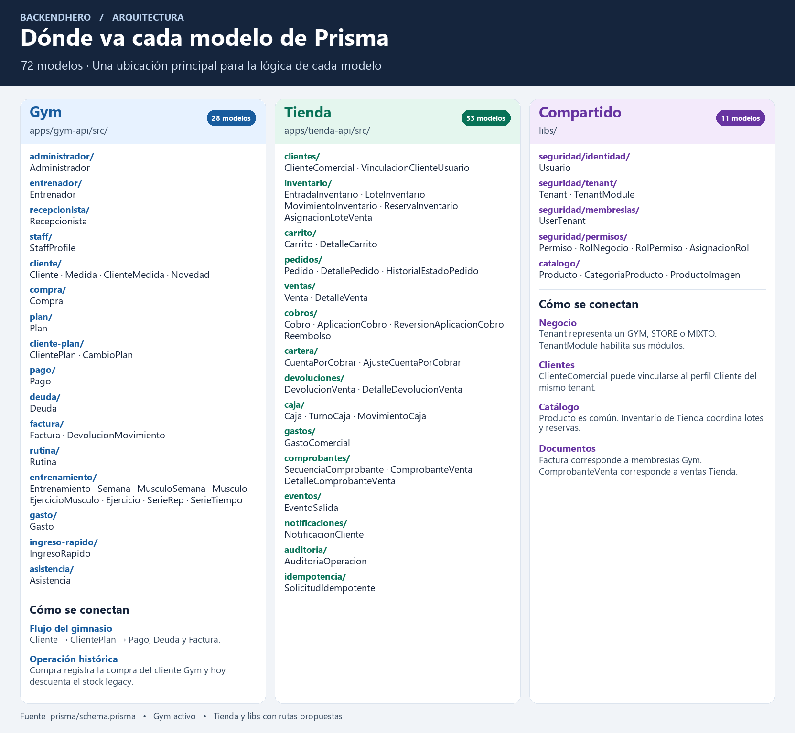

# Dónde va cada modelo de Prisma en BackendHero

El esquema define **72 modelos**. Esta guía propone **28 en Gym, 33 en Tienda y 11 con lógica compartida en `libs`**. La asignación identifica qué módulo se encarga de cada dato y sus reglas. Las tablas se definen juntas en [`prisma/schema.prisma`](../prisma/schema.prisma) y sus cambios se versionan en [`prisma/migrations/`](../prisma/migrations/).

Hoy solo `gym-api` tiene código de aplicación. Los destinos en `tienda-api` y `libs` son propuestos. Los modelos compartidos que Gym ya usa aparecen abajo con su ubicación actual para que puedas incorporar Tienda sin trasladar todo de golpe.

## Cómo leer la guía

| Área | Prefijo de la ruta | Qué va ahí |
| --- | --- | --- |
| Gym | `apps/gym-api/src/` | Operación deportiva y flujos históricos del gimnasio. |
| Tienda | `apps/tienda-api/src/` | Compradores, inventario comercial, pedidos, ventas y caja. |
| Compartido | `libs/` | Identidad, acceso por negocio y reglas comunes del catálogo. |

Cada fila asigna un responsable principal. En un módulo Nest, `*.module.ts` conecta las dependencias, `*.service.ts` implementa los casos de uso, `*.controller.ts` expone los casos de uso que requiere el cliente y `dto/` valida sus entradas. Los detalles, movimientos, historiales y secuencias se escriben desde el servicio responsable de la operación. Por ejemplo, `PedidoService` agrega `DetallePedido` e `HistorialEstadoPedido` al procesar una confirmación, con el servicio de inventario para las reservas.

## Gym · 28 modelos

En la columna «Carpeta», agrega `apps/gym-api/src/` al principio. El módulo `cliente/` también es el destino propuesto de las medidas y novedades.

| Modelo | Carpeta | Responsabilidad |
| --- | --- | --- |
| `Administrador` | `administrador/` | Compatibilidad del perfil administrador histórico. Los listados históricos también pasan por `usuarios/`. |
| `Entrenador` | `entrenador/` | Perfil histórico de entrenador con horario y sueldo. Los flujos vigentes de personal se coordinan en `staff/`. |
| `Recepcionista` | `recepcionista/` | Perfil histórico de recepción con horario y sueldo. Los flujos vigentes de personal se coordinan en `staff/`. |
| `StaffProfile` | `staff/` | Perfil laboral por usuario, negocio y rol. Se usa con `UserTenant` para administrar el personal Gym. |
| `Cliente` | `cliente/` | Perfil deportivo ligado a `Usuario`, con objetivos, horario y vinculación biométrica opcional. |
| `Medida` | `cliente/` | Catálogo de tipos de medida corporal. |
| `ClienteMedida` | `cliente/` | Valores de medidas de un cliente del gimnasio. |
| `Novedad` | `cliente/` | Incidencia del cliente y estado de resolución. |
| `Compra` | `compra/` | Registro histórico de la compra de un producto por un cliente Gym. El flujo vigente también descuenta stock legacy. |
| `Plan` | `plan/` | Oferta de membresías y sus condiciones. |
| `ClientePlan` | `cliente-plan/` | Asignación, vigencia y estado de la membresía del cliente. |
| `CambioPlan` | `cliente-plan/` | Cambio de membresía y cálculo del traslado o devolución. `factura/` actualiza el saldo al registrar devoluciones. |
| `Pago` | `pago/` | Pago asociado a una membresía de Gym. |
| `Deuda` | `deuda/` | Deuda de una membresía y su resolución. |
| `Factura` | `factura/` | Documento asociado a `ClientePlan`, con importes y saldo del flujo Gym. |
| `DevolucionMovimiento` | `factura/` | Registro de dinero devuelto por un cambio de plan, asociado a la factura. |
| `Rutina` | `rutina/` | Rutina de entrenamiento asignada al cliente. |
| `Entrenamiento` | `entrenamiento/` | Estructura de entrenamiento asociada a la rutina. |
| `Semana` | `entrenamiento/` | Bloque semanal del entrenamiento. |
| `MusculoSemana` | `entrenamiento/` | Asociación de grupos musculares a una semana. |
| `Musculo` | `entrenamiento/` | Catálogo de músculos usado por la planificación. |
| `EjercicioMusculo` | `entrenamiento/` | Ejercicio asignado dentro del grupo muscular planificado. |
| `Ejercicio` | `entrenamiento/` | Catálogo de ejercicios reutilizados en el plan. |
| `SerieRep` | `entrenamiento/` | Series definidas por repeticiones. |
| `SerieTiempo` | `entrenamiento/` | Series definidas por tiempo. |
| `Gasto` | `gasto/` | Egreso del gimnasio. |
| `IngresoRapido` | `ingreso-rapido/` | Ingreso manual simplificado del gimnasio. |
| `Asistencia` | `asistencia/` | Registro de ingreso del cliente. `integrations/zkbio/` adapta los eventos biométricos. |

## Tienda · 33 modelos

En la columna «Carpeta», agrega `apps/tienda-api/src/` al principio. Las carpetas agrupan casos de uso para que puedas implementar una operación completa sin repartir sus detalles entre controladores independientes.

| Modelo | Carpeta | Responsabilidad |
| --- | --- | --- |
| `ClienteComercial` | `clientes/` | Ficha comercial para ventas, cartera y portal. Puede existir sin cuenta ni perfil deportivo. |
| `VinculacionClienteUsuario` | `clientes/` | Verificar y revocar la relación entre la ficha comercial y una cuenta `Usuario`. |
| `EntradaInventario` | `inventario/` | Registrar ingresos de mercadería con su costo y responsable. |
| `LoteInventario` | `inventario/` | Existencias por lote y costo de origen. |
| `MovimientoInventario` | `inventario/` | Registro de entradas, salidas, reservas y otros cambios de existencias según el tipo de movimiento. |
| `ReservaInventario` | `inventario/` | Retener, consumir o liberar unidades de un detalle de pedido. |
| `AsignacionLoteVenta` | `inventario/` | Registrar qué lotes consumió cada detalle de venta y su costo. La venta invoca esta operación. |
| `Carrito` | `carrito/` | Carrito del portal para el cliente comercial. |
| `DetalleCarrito` | `carrito/` | Producto y cantidad en el carrito. |
| `Pedido` | `pedidos/` | Confirmación, retiro, vencimiento y cancelación del pedido. Coordina inventario y venta. |
| `DetallePedido` | `pedidos/` | Cantidades y precios congelados al confirmar el pedido. |
| `HistorialEstadoPedido` | `pedidos/` | Trazabilidad de las transiciones del pedido y su responsable. |
| `Venta` | `ventas/` | Venta de mostrador o de un pedido del portal. Coordina stock, cobro o crédito y caja. |
| `DetalleVenta` | `ventas/` | Cantidades, precio, impuestos y costo históricos de cada línea vendida. |
| `Cobro` | `cobros/` | Registrar dinero recibido, medio de pago y estado. |
| `AplicacionCobro` | `cobros/` | Aplicar parte o todo un cobro a una venta y, cuando corresponde, a una cuenta por cobrar. |
| `ReversionAplicacionCobro` | `cobros/` | Revertir una aplicación conservando el registro original. |
| `Reembolso` | `cobros/` | Registrar devolución de dinero y coordinar su efecto en caja cuando corresponda. |
| `CuentaPorCobrar` | `cartera/` | Saldo exigible por venta a crédito de un cliente comercial. |
| `AjusteCuentaPorCobrar` | `cartera/` | Ajuste trazable al saldo o importe exigible. |
| `DevolucionVenta` | `devoluciones/` | Tramitar la devolución comercial y coordinar stock, cartera y reembolso según el caso. |
| `DetalleDevolucionVenta` | `devoluciones/` | Cantidades, artículos y destino de las unidades devueltas. |
| `Caja` | `caja/` | Caja operativa del negocio. |
| `TurnoCaja` | `caja/` | Apertura, cierre y cuadre del turno. |
| `MovimientoCaja` | `caja/` | Registro de ingresos y egresos del turno. |
| `GastoComercial` | `gastos/` | Egreso comercial, con movimiento de caja cuando corresponda. |
| `SecuenciaComprobante` | `comprobantes/` | Consecutivo `COMP-` por tenant, asignado de forma atómica al emitir. |
| `ComprobanteVenta` | `comprobantes/` | Emisión y anulación del comprobante interno asociado a una venta. |
| `DetalleComprobanteVenta` | `comprobantes/` | Copia histórica de los conceptos e importes que se emitieron. |
| `EventoSalida` | `eventos/` | Cola persistente para publicar eventos comerciales con reintentos. |
| `NotificacionCliente` | `notificaciones/` | Aviso persistente del portal para un comprador, con control de titularidad y lectura. |
| `AuditoriaOperacion` | `auditoria/` | Registrar actor, acción, motivo y correlación de una operación comercial. |
| `SolicitudIdempotente` | `idempotencia/` | Identificar reintentos y resolverlos sin duplicar la operación. |

## Compartido · 11 modelos

Identidad, negocios, permisos y catálogo tienen librerías implementadas. Permisos ofrece una base interna mientras Gym sigue en `LEGACY`. Cada app conserva sus controladores, DTO y políticas específicas. `EventoSalida`, `AuditoriaOperacion` e `idempotencia/` tienen su primer consumidor previsto en Tienda.

| Modelo | Carpeta propuesta | Responsabilidad y punto de partida |
| --- | --- | --- |
| `Usuario` | `libs/identidad/` | Cuenta global y credenciales. Gym comparte las consultas y altas mediante `@app/identidad`. |
| `Tenant` | `libs/negocios/` | Datos y plan del negocio. Gym coordina su gestión desde `tenant/` y `auth/`. |
| `TenantModule` | `libs/negocios/` | Habilitación de `GYM` y `STORE` por negocio. Catálogo consulta el estado del módulo. |
| `UserTenant` | `libs/negocios/` | Vinculación de personal entre cuenta y negocio, estado y rol. Gym conserva las reglas de contexto y los perfiles laborales. |
| `Permiso` | `libs/permisos/` | Catálogo global de permisos definidos por la aplicación y asociados a un módulo. |
| `RolNegocio` | `libs/permisos/` | Rol protegido o configurable de un negocio. |
| `RolPermiso` | `libs/permisos/` | Permisos de un rol. Sus cambios actualizan la versión de autorización de las membresías afectadas. |
| `AsignacionRol` | `libs/permisos/` | Rol vigente de una membresía y quién lo asignó. |
| `Producto` | `libs/catalogo/` | Identidad, datos y precio vigente del producto por tenant. Gym lo gestiona hoy desde `producto/` y modifica stock desde `compra/`. |
| `CategoriaProducto` | `libs/catalogo/` | Clasificación de productos por tenant y módulo `GYM` o `STORE`. |
| `ProductoImagen` | `libs/catalogo/` | Imágenes y orden de presentación del mismo producto. |

`libs/contratos/` puede alojar interfaces que ambas apps consuman, por ejemplo el contexto de negocio. `libs/utilidades/` puede alojar funciones generales compartidas. `libs/facturacion/` queda como espacio para funciones de formato o renderizado cuando haya un uso común concreto. Los documentos de negocio tienen sus responsables en `factura/` y `comprobantes/`.

## Límites que afectan la implementación

### Negocio e identidad

- Una tienda es un `Tenant` con `tipoNegocio = STORE`. Un negocio `MIXTO` puede habilitar ambos módulos con `TenantModule`. Cuando exista el módulo de configuración de Tienda, su controlador podrá delegar las operaciones comunes a `NegociosModule`.
- `Usuario` es la cuenta común. `Cliente` es el perfil deportivo. `ClienteComercial` es la ficha del comprador, con enlace opcional a `Cliente` dentro del mismo tenant. Para dar acceso al portal, Tienda verifica `VinculacionClienteUsuario` y comprueba la coherencia de titularidad cuando hay un perfil Gym vinculado.
- Conserva el flujo de login y selección de contexto al añadir clientes de tienda. En rutas protegidas, obtén `tenantId` del contexto autenticado y comprueba el módulo habilitado y el acceso al recurso. Gym sigue usando el rol de `UserTenant` con el guard actual en modo `LEGACY`. La transición a `PERMISOS` requiere adaptar JWT, selección de contexto, guards y gestión de personal antes de habilitarla.

### Catálogo y stock

- Un negocio mixto puede usar el mismo `Producto` y su stock en los dos flujos. El catálogo compartido se encarga de datos como nombre, SKU, categoría, imágenes y precio. La propuesta asigna a `inventario/` la operación sobre lotes, movimientos y reservas en modo `LOTES`.
- `CompraService` descuenta `Producto.stock` en el flujo vigente. Antes de activar `LOTES` en un producto que también vende Gym, adapta ese camino para usar la misma operación de inventario y la misma transacción. `MovimientoInventario.compraLegacyId` permite referenciar la compra de origen. El acceso a esa operación debe pasar por un contrato definido, con una implementación común extraída cuando Gym también la necesite. Evita que una app importe los módulos internos de la otra.

### Dinero y efectos secundarios

- Gym registra `Pago`, `Deuda` y `Factura` por membresía. Tienda registra `Cobro`, `CuentaPorCobrar` y `ComprobanteVenta` por venta. Cada módulo conserva su historial e importes. `ComprobanteVenta` corresponde a un comprobante interno.
- El caso de uso que coordina una operación, como `ventas/`, abre la transacción y pasa ese contexto a inventario, cobros, cartera y caja según corresponda. Escribe los eventos y el registro idempotente que esa operación requiera en la misma transacción. Las notificaciones del portal se procesan desde los eventos y se entregan al comprador autorizado.

## Orden sugerido para crear las carpetas y servicios

1. **Acceso y base de Tienda.** Crear el arranque de `tienda-api`, resolver tenant y módulos, adaptar identidad y permisos y cubrir el aislamiento entre negocios. Tomar `auth/`, `tenant/` y `staff/` de Gym como referencia de compatibilidad.
2. **Clientes y catálogo.** Implementar `clientes/` y los endpoints de catálogo en Tienda sobre las reglas comunes de `libs/catalogo/`. Probar compradores sin cuenta, vínculo verificado y un catálogo de negocio mixto.
3. **Inventario.** Crear `inventario/` con entradas, lotes y movimientos, preparar la transición del stock legacy y probar escrituras concurrentes antes de habilitar `LOTES`.
4. **Venta de mostrador.** Crear `ventas/`, `cobros/`, `cartera/`, `caja/`, `gastos/`, `devoluciones/` y `comprobantes/`. Incorporar idempotencia, auditoría y eventos desde la primera operación que los necesite.
5. **Portal y retiro.** Añadir `carrito/`, `pedidos/`, reservas e historial y completar `notificaciones/`. Probar confirmación, expiración y retiro sobre el mismo stock.

## Fuentes del repositorio

- [Esquema de Prisma](../prisma/schema.prisma) y [migraciones vigentes](../prisma/migrations/).
- [Arquitectura actual del backend](./ARQUITECTURA_BACKEND.md) y [diseño funcional de STORE](./DISENO_BASE_DATOS_STORE.md).
- [Estado de implementación del esquema STORE](./ESQUEMA_STORE_IMPLEMENTADO.md) y [módulo raíz de Gym](../apps/gym-api/src/app.module.ts).
